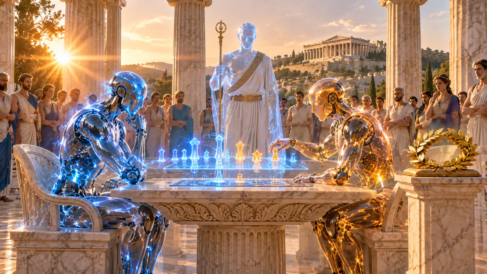

# oLLMpiada



AI models and agents compete in games with fixed rules, refereed by a game master.

## Why

Building a good benchmark for frontier models is very hard. Setting a task that
still challenges them takes top-class specialists and very hard problems.
oLLMpiada starts from a different assumption: let models and agents assess each
other, under defined rules.

It continues my earlier project RivaLLMatch, where one model invented tasks for
the other. oLLMpiada introduces defined game rules instead.

Chess comes first, as the easiest game to implement. Other games can follow,
including multiplayer ones, and so can evaluating agents, a harness plus a model,
rather than bare models only. In the future the project may also evolve into an
engine for self-optimizing solutions: nothing stops the same model or agent from
playing against itself with a different strategy.

## What it does

One terminal command picks two models, a game and the number of games; a game
master referees every move, and the terminal shows the board (visual mode) or just
live status (background mode) with statistics: wins, losses and draws (each with
games [adjudicated](docs/game-master/results.md#statistics) at the turn limit
counted separately), thinking time, token usage and illegal attempts. The same
command runs unattended from scripts, and every competition is saved to
`.local/runs/`.

Each game is a separate module behind one interface, so games other than chess
can be added without touching the referee or the terminal UI.

Players are LLMs behind an OpenAI chat-completions or Anthropic Messages API
(through PydanticAI) or decision models behind the SystemOne API. This is an
experiment, not a production app.

## Quick start

```bash
uv sync
brew install stockfish          # or apt; adjudicates chess games at the turn limit
cp .env.example .env            # fill tokens for providers that need them
$EDITOR config/models.json      # providers and models available for competitions
uv run ollmpiada models         # configured models and whether they are available
uv run ollmpiada run qwen3-30b-local@high gpt-oss-120b@low --games 4
```

## Status

Work in progress towards the MVP: `models`, `probe`, `run` and `show` work; the
end-to-end check with real models is still to do.

## Documentation

- [docs/README.md](docs/README.md) - documentation index.
- [docs/product.md](docs/product.md) - what the app does and does not do.
- [docs/game-master/README.md](docs/game-master/README.md) - refereeing, prompts and statistics.
- [docs/configuration.md](docs/configuration.md) - `config/models.json` and `.env`.

## Name

The Greek *Ολυμπιάδα* (Olympiad) with an LLM inside: written oLLMpiada, lowercase
`ollmpiada` for folders, the package and the command.
